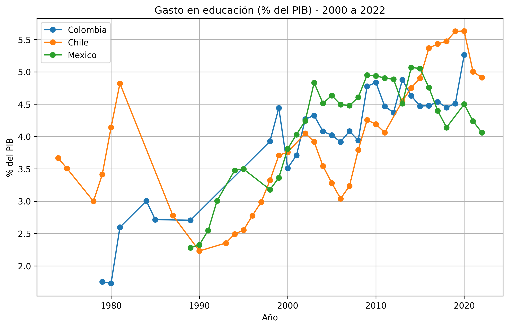
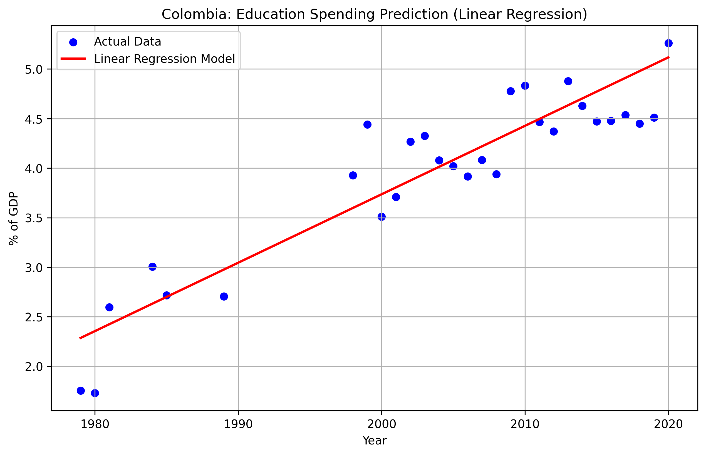

# Education Spending & Outcomes in Latin America 📊

## 📌 Overview
This project analyzes the historical trends of government expenditure on education (as a % of GDP) across Latin American countries. It includes exploratory data analysis (EDA) and a baseline Machine Learning model to understand spending behavior over time.

## 📊 Data Source
The data is fetched directly from the **World Bank Open Data API** using the indicator `SE.XPD.TOTL.GD.ZS` (Government expenditure on education, total % of GDP).

## 🛠️ Technologies Used
- **Python** (pandas, numpy)
- **Data Visualization** (matplotlib, seaborn)
- **Machine Learning** (scikit-learn)
- **Jupyter Notebooks** for analysis and reporting

## 📈 Key Findings
1. **Upward Trend:** Most Latin American countries have significantly increased their education spending since the 1980s and 1990s.
2. **Volatility:** Spending is highly susceptible to economic crises (e.g., drops in the late 1990s and 2010s).
3. **Predictive Power:** A simple Linear Regression model shows a general upward trend, but indicates that education spending is non-linear and depends on external economic factors.

## 🖼️ Visualizations

### 1. Historical Trends (Colombia, Chile, Mexico)


### 2. Machine Learning Prediction (Colombia)


## 🚀 How to Run
1. Clone this repository:
   ```bash
   git clone https://github.com/JuanDiegoLealSalazar/education-spending-and-outcomes.git